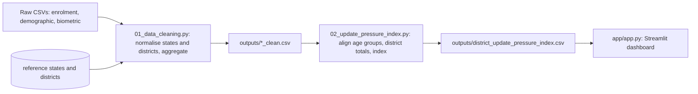

# Aadhaar Update Pressure Intelligence System

A decision-support dashboard that ranks Indian districts by **how much pressure Aadhaar update services are under**, using aggregated public UIDAI enrolment, demographic-update and biometric-update counts. It answers where demand is building, which age group is driving it, and how urgently capacity is needed.

**Links:** [GitHub](https://github.com/shriram-s7/AADHAAR-PRESSURE-UPDATE-INTELLIGENCE-SYSTEM) · [Demo video](https://youtu.be/P_dZWWPQM_c)

## Overview

Aadhaar holders must update demographic details and refresh biometrics (notably when children turn 5 and 15), and update centres are often stretched in some districts while idle in others. This hackathon project combines three UIDAI datasets, cleans and standardises the state and district names, and computes a per-district **Update Pressure Index (UPI)** from 0 to 1. A Streamlit app then lets an administrator inspect one district, see why it is under pressure, and view a national ranking. Only aggregated counts by date, state, district and pincode are used; there is no personal Aadhaar data.

## Features

- **District view:** choose a state and district to see its UPI, pressure level (LOW / MODERATE / HIGH / CRITICAL), total updates and enrolments, age-driven pressure (youth 5-17 vs adult 18+), update composition, a recommended action, and a state-wide comparison table.
- **National pressure ranking:** all districts sorted by UPI.
- **Reproducible data pipeline:** two scripts clean the raw CSVs and build the index.

## How it works



The index (`notebook/02_update_pressure_index.py`) is built per district from these ratios:

| Quantity | Definition |
|---|---|
| `total_updates` | demographic + biometric updates for ages 5-17 and 18+ |
| `update_intensity` | `total_updates / (total_enrolment + 1)` |
| `youth_pressure` | share of updates in the 5-17 group |
| `adult_pressure` | share of updates in the 18+ group |
| `biometric_ratio` | share of updates that are biometric |

Each of the four is min-max normalised across districts and combined as

`UPI = 0.4 x update_intensity + 0.3 x youth_pressure + 0.2 x biometric_ratio + 0.1 x adult_pressure`

Levels: CRITICAL at UPI >= 0.75, HIGH >= 0.5, MODERATE >= 0.25, otherwise LOW. The weights and thresholds are hand-chosen heuristics, not learned from data. This is a rule-based index; no machine-learning model is used.

## Tech stack

| Layer | Technology |
|---|---|
| Data processing | Python, pandas, NumPy |
| Dashboard | Streamlit |
| Data | UIDAI aggregated CSVs in `data/` (enrolment, demographic, biometric) plus reference state/district lists |

## Project structure

```text
app/app.py                          Streamlit dashboard
notebook/01_data_cleaning.py        clean and aggregate raw CSVs
notebook/02_update_pressure_index.py  build the district Update Pressure Index
data/                               raw UIDAI CSV parts and reference state/district lists
outputs/                            cleaned CSVs and district_update_pressure_index.csv
requirements.txt
```

## Getting started

Prerequisites: Python 3.10 or newer. No environment variables or API keys are needed.

Note: `requirements.txt` is out of date. It lists packages the code does not use (fastapi, uvicorn, scikit-learn, python-dotenv) and omits `streamlit`, which the dashboard needs. Install what is actually used:

**Windows (PowerShell)**

```powershell
python -m venv .venv
.\.venv\Scripts\Activate.ps1
pip install pandas numpy streamlit
streamlit run app\app.py
```

**Linux / macOS**

```bash
python3 -m venv .venv && source .venv/bin/activate
pip install pandas numpy streamlit
streamlit run app/app.py
```

The repository already contains the generated `outputs/` files, so the dashboard runs immediately.

To regenerate the outputs from the raw data:

```powershell
$env:PYTHONUTF8 = "1"        # the scripts print emoji; without this the Windows console can raise UnicodeEncodeError
python notebook\01_data_cleaning.py
python notebook\02_update_pressure_index.py
```

## Usage

1. Run `streamlit run app/app.py` and open the URL it prints.
2. Pick a state and district in the sidebar; read the UPI, level, age breakdown and the suggested action.
3. Click **National Pressure Ranking** to see districts ranked by UPI, and use the Back button to return.

## Tests

There are no automated tests. As a reproducibility check while writing this README, the two pipeline scripts were run on a copy of the repository: the cleaned enrolment, demographic and biometric tables matched the committed ones in row count (66,463 / 85,353 / 79,099), but the regenerated index had 1,040 districts in 46 states versus 1,039 in 45 in the committed `outputs/` file (pressure levels: 1 CRITICAL, 7 HIGH, 878 MODERATE, 154 LOW regenerated versus 153 LOW committed). The cause was not investigated. The dashboard was not launched.

## Status and limitations

- Working analysis pipeline and dashboard; advisory analytics only.
- The index weights, thresholds and the recommended actions are heuristic; they were not validated against real operational outcomes.
- Demographic and biometric data are only split into 5-17 and 17+/18+ groups, so the "child" group is zero for those sources.
- District and state names depend on string cleaning against the reference lists; a few names are shown with substituted separators for readability (`pretty_district`).
- `requirements.txt` is inaccurate (see above); there is no CI or test suite.

## License

No license specified.
